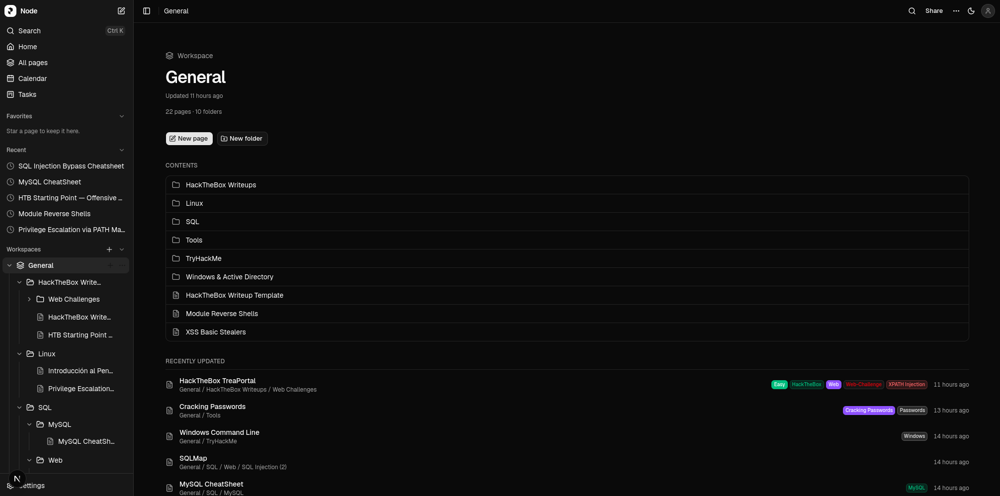

<p align="center">
  
</p>

<p align="center">
  
</p>

# Node Markdown Editor

A modern markdown editor and workspace application for writing, organizing, and navigating project notes in a focused, production-ready environment.

## Overview

Node Markdown Editor is built to combine fast markdown authoring with practical project organization tools. It helps teams and individuals capture ideas, manage notes, and maintain a clear structure across workspaces.

## Features

- Rich markdown editing experience
- Structured workspace and page organization
- Search, task, and calendar views
- Clean, modern interface powered by Next.js and shadcn/ui

## Getting started

```bash
npm install
npm run dev
```

Then open http://localhost:3000 in your browser.

## Tech stack

- Next.js
- React
- TypeScript
- Tailwind CSS
- shadcn/ui
