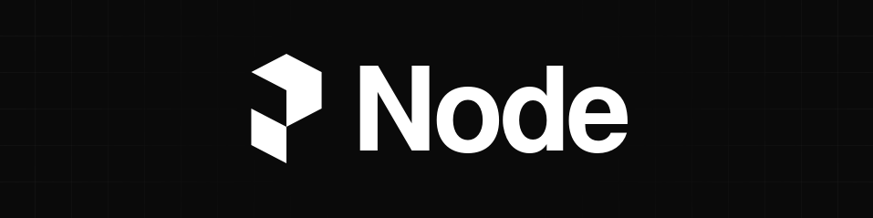
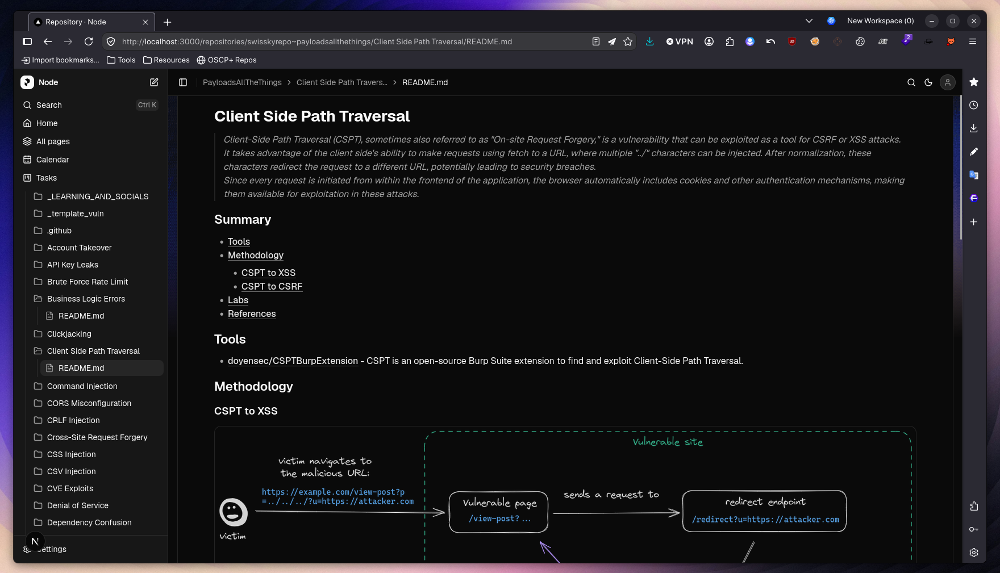

<p align="center">
  
</p>

<p align="center">
  <p align="center">Node, a Next.js Markdown editor,
focused for Pentesting. To build technical notes</p>
  <p align="center">
    
    
    
    
  </p>
</p>

<p align="center">
  
</p>

## Features

- Write Markdown and MDX in a visual editor or source view.
- Organize pages into workspaces and folders, with tags and search.
- Track work on a kanban task board and calendar.
- Use local developer utilities for encoding and reverse-shell references.

## Get started

Requirements: Node.js and pnpm.

```bash
git clone https://github.com/0x0f2Root/Node.git
cd Node
pnpm install
pnpm dev
```

Open [http://localhost:3000](http://localhost:3000). The **Getting Started** workspace introduces the editor, workspaces, tasks, calendar, and tools. Create your own pages from the sidebar; pages are Markdown files.

## Optional HackTheBox integration

The HackTheBox tracker is optional. Add a profile in **Settings → HackTheBox** to show public profile statistics. To load the individual solve feed, create an App Token, copy `.env.example` to `.env.local`, set `HTB_APP_TOKEN`, and restart the dev server. Keep `.env.local` private; it is ignored by Git.

## Where data is stored

- Markdown pages and images are stored in `data/pages/` in the project folder.
- Tasks and calendar events are stored in this browser's local storage. They do not sync between browsers or devices.
- Editor preferences, favorites, recent pages, and imported repository snapshots are also kept in browser storage. Large snapshots and background images use IndexedDB.
- Activity history, tag colors, and the optional HackTheBox cache are written to generated files under `data/`.

Git ignores personal pages and generated workspace files. Back up the `data/` folder for your notes, and export or separately back up browser data if you want to keep tasks, events, settings, or imported repositories. For hosted deployments, use persistent storage for files; ephemeral server disks can lose them after a restart or redeploy.

## Development

```bash
pnpm dev        # start the development server
pnpm build      # create a production build
pnpm start      # serve the production build
pnpm lint       # run ESLint
pnpm typecheck  # check TypeScript
```

See [docs/data-and-backups.md](docs/data-and-backups.md) for the storage and backup details.
